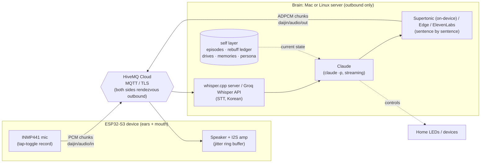

# daijin

> **A lonely developer's friend and assistant.**
> An AI voice-conversation IoT device I built myself, wired into my own systems, that I can tell to do *anything*.

Tap a button, talk to the device → audio travels through the cloud → an AI agent (**Claude**) thinks → the device answers back in speech, in a voice I designed.
It doesn't just reply — it **actually controls my home and my computer.**

Built from a single cable up, on an ESP32-S3 (Freenove FNK0082) + a brain (a Mac at home, or any small Linux box/VPS) + cloud MQTT.

## Demo

https://github.com/user-attachments/assets/48c4693b-7dae-40b5-aa2d-9cc7cdb3fe40

One take on the voice side: I talk to daijin at home, the Claude brain on my Mac decides, and two nodes on their own networks act — a cat-treat dispenser in the next room and a device waiting in a park.

## How is this different from Siri?

daijin is not "a better Siri." It's a **different kind of thing**.

- **The brain is an agent that reasons and acts, not a command matcher.** Siri pattern-matches fixed commands. daijin's brain is Claude — it holds a real conversation and *acts* on my scripts, MQTT devices, and data through shell access on my Mac.
- **I own it and I can rewire it.** Personality, prompts, and the set of allowed actions are mine to define. Closed assistants (Siri, Alexa, even ChatGPT voice) can't give you an agent that *works inside your own infrastructure*.
- **It's a separate being, not an app on my phone.** Something you place on a desk or carry around. A relationship, not a tool.

→ daijin's differentiation is **ownership + agency**: a fully-owned, open-ended agent device embedded in the systems of my life.

## Architecture (portable — works even when you take it outside)



- **They meet at a cloud broker** → works on any network: home WiFi or a phone hotspot on LTE. The brain only goes outbound (no inbound exposure needed), so it can be a Mac at home **or a headless Linux server** — the device does not care which. See [Run the brain on a Linux server](#run-the-brain-on-a-linux-server-no-mac-needed).
- **Fully streaming reply pipeline**: Claude's answer is split into sentences *as it generates* → each sentence is synthesized and published immediately → the device starts speaking after the **first sentence**, not the full answer. Honest numbers: a full round trip (record → STT → agent → TTS → playback) typically takes **6–22 s** depending on how much the agent thinks and does — streaming hides part of that, but this is a conversation, not real-time.
- **Audio protocol** ([docs/chunking-protocol.md](docs/chunking-protocol.md)): PCM 16 kHz/16-bit mono, chunked over MQTT with a 4-byte header `[clipId][seq:2][flags]`. **Both directions are IMA ADPCM-compressed 4:1** — the ~19KB/s bandwidth ceiling applies to the ESP32's send buffer too, so raw 32KB/s PCM can't keep up in either direction. Downstream plays through a jitter ring buffer; upstream is drained by a dedicated capture task so a blocking TLS publish never drops samples.
- The brain = `claude -p` (it's an agent, so it controls the home's LEDs and devices by voice) with a **pinned session** for cross-conversation memory. **Security trade-off, stated plainly**: the agent runs with broad tool access (shell, file read/write, web search/fetch) so it can genuinely act on the Mac — which means the **MQTT broker credential *is* the security boundary**: anyone who can publish to the audio topic can drive the agent. Mitigations in place: TLS to the broker with certificate verification on every side (the firmware keeps verifying even when NTP is blocked), credentials kept only in gitignored files, the brain makes outbound connections only, and the system prompt requires spoken confirmation before destructive actions (a soft guard, not a hard one). Give the device and the nodes their own broker logins limited to their topics, so a node left outside cannot reach the agent: [docs/broker-credentials.md](docs/broker-credentials.md).

### Why ADPCM? (a physics lesson)

The free broker lives in the EU: ~300 ms RTT from Korea. The ESP32's lwIP TCP receive window is ~5.7 KB and fixed. Max throughput = window ÷ RTT ≈ **19 KB/s** — physically below the 32 KB/s that raw PCM playback needs. No amount of code fixes that; compressing to 8 KB/s does.

## Extensibility — bolting on other agents (open by design)

daijin **separates the "ears + mouth" (device) from the "brain" (agent) over MQTT topics**. So the brain is swappable, and daijin itself can be used as the *voice I/O device for any agent*.

- **Swap the brain**: anything in place of `claude -p` — OpenAI, Gemini, a local LLM (EXAONE), the Claude Agent SDK, etc. STT/TTS and the device stay the same.
- **Generic voice I/O**: subscribe/publish just the `daijin/text/in` (what I say) and `daijin/text/out` (the reply) topics, and any agent can use daijin as its ears and mouth (daijin handles audio, STT, TTS).
- **Multi-agent routing**: dispatch by transcribed intent to a home-control agent / coding agent / chit-chat agent.
- **MCP integration**: expose daijin's actions (speaking, device control) as MCP tools, or have the brain wire up multiple MCP servers to extend its abilities modularly.

> The topic contract (`daijin/audio/*`, `daijin/text/*`) already acts as the interface, so swapping the brain or attaching an external agent is just *one adapter layer*. (Current brain = Claude; the extensions are roadmap.)

## A self outside the model

Where does daijin's "self" live? Not in the model. It lives next to the brain, in code and a SQLite file, so the model that turns it into words can be Claude today and a local model later without daijin becoming someone else. Design: [docs/design-self-layer.md](docs/design-self-layer.md).

- **A body, wired to behaviour.** The device and nodes already report temperature, signal and outages. `initiative.py` turns them into drives (*contact*: hours since the last conversation; *node loss*: how long a node has been gone; *body*: heat and weak signal) and, when one rises far enough, speaks first.
- **An admissibility filter before speaking.** Quiet hours, a daily budget, a per-drive interval that doubles after each refusal, hours to avoid, and never in the middle of a conversation. Every time it stays quiet, the reason is logged.
- **A rebuff ledger.** Asking wrong is the default (a mother and infant are out of sync over 70% of the time; repair is what matters), so the ledger records what happened *after* daijin spoke first: engaged, a short acknowledgement, refused with a reason, told to stop, or no answer. Each outcome changes that drive's policy, and after a refusal the next line opens with an explanation or a promise — never a denial.
- **A current-state block.** Every turn the agent is handed its body readings, which nodes are up, how its last proactive lines went, its top memories and its persona. It answers "블루 켜져 있어?" or "아까 나한테 뭐 물어봤어?" without calling a tool.
- **Nights.** `reflect.py` looks back over the day in a fresh session: it writes memories (superseding, never deleting), corrects the ledger, fills a "wanted to ask less" column, and may propose a persona rewrite. Only a person can approve that, with `persona.py`.

## Thinking without outside services

The goal is that daijin keeps talking even if every outside AI service is gone. Each piece now has a way to run at home:

- **Thinking engines are swappable.** `BRAIN_ENGINE=claude` (default), `local` (any OpenAI-compatible endpoint: Ollama, llama.cpp, LM Studio, vLLM), or an order such as `claude,local`, which falls back to the local model when Claude gives no answer. The local engine gets three tools only (node command, fleet status, device status), invented commands are refused, and a reply that claims an action no command carried out is replaced with the truth. Its conversation memory comes from the self layer instead of a model session.
- **Some answers need no model.** Clear short commands ("레드 모터 돌려 줘") and time, date and weekday questions are answered by rules in about 2 seconds (`fastpath.py`). A 4B model got the weekday wrong one time in three; the clock does not.
- **Ears and voice at home.** A whisper.cpp server for speech recognition, Supertonic for speech, both on the CPU or GPU of the machine running them.
- **A home broker when the internet is gone.** With `MQTT_LOCAL_HOST` in the firmware secrets (a `.local` name is looked up with mDNS), the device and nodes move to a mosquitto on the home WiFi after three failed cloud connects or when there is no clock to check certificates, and go back to the cloud every five minutes.
- **Offline mode.** `voice/offline-mode.sh start` runs the whole brain on one Mac with all of the above. Measured on an M1 Pro with qwen3.5:4b: rule answers 2-3 s, conversation 9-17 s. `sync` copies the server's self layer here first and `push` merges what was said offline back into it afterwards, so nothing said during an outage is forgotten.
- **A home helper for the server.** `voice/mac-helper.sh` keeps whisper running on a Mac and exposes it and Ollama to the server over Tailscale only, so the server falls back to the Mac's model when Claude fails.

The local model is clearly weaker than Claude: it misplaces dates, cannot search the web, and rarely draws memories out of a day in reflection. It is a floor to stand on, not a replacement yet.

## Current status

- **Phase 2 shipped** — the device itself listens and speaks: tap BOOT to record, tap again to send; the reply streams back and plays with **zero underruns**, at home or on a phone hotspot outside.
- **Voice**: **Supertonic** (`TTS_ENGINE=supertonic`) speaks Korean on the CPU with no network, about 0.2× real time even on a 2-vCPU VPS; **Edge TTS** (free neural voice) and a custom **ElevenLabs** voice remain, and the engines fall through to one another.
- **Recording** ends by itself 1.5 s after the speaker goes quiet (energy VAD on the device, tuned on real conversations: thinking pauses up to 1.4 s no longer cut a sentence), or with a second tap.
- **Self layer** running: drives, the rebuff ledger, nightly reflection; see above.
- **Local thinking and offline mode** working end to end; the firmware falls back to a home broker (checked on the device and both nodes with a test build that treats the cloud as down).
- **Device UX**: ready chirp through the speaker, dim-green idle LED, status colors for record/upload/play (LTE connects can take 30+ seconds — sound beats a blinking LED).
- Earlier milestones: HTTP LAN control → MQTT LAN → HiveMQ Cloud portable control (verified from a phone on LTE) → cloud voice round-trip with a fake device.

## Hardware

- **Board**: ESP32-S3-WROOM (Freenove FNK0082 kit) on the GPIO extension board + breadboard
- **Mic**: INMP441 I2S MEMS (WS=1, SCK=2, SD=42, L/R→GND) — must be read as **32-bit I2S frames**, top 16 bits used
- **Speaker**: 8Ω 2W through the kit's Audio Converter & Amplifier module (PCM5102 DAC: BCK=14, LCK=12, DIN=13, SCK unconnected)
- **Power**: USB or a plain power bank — it's a take-it-with-you device

## Layout

```
sketches/   ESP32 firmware (arduino-cli)
  01~06               learning sketches (LED/WiFi/servo/sensor)
  10-remote-led       HTTP remote LED (early)
  11-mqtt-led         LAN MQTT
  12*-funnel          Tailscale Funnel attempt (unstable for portable use — kept as a record)
  13-cloud-led        HiveMQ Cloud (portable ✅)
  14-daijin           the daijin device: mic → cloud → speaker ✅
  15-home-node        home fleet node: one firmware per NODE_NAME — retained heartbeat, MQTT LWT, servo/relay/DHT/PIR switches
                      (both: broker_choice.h falls back to a home broker when the cloud is out of reach)
  test-mic            mic verification (record → HTTP → whisper)
  test-speaker        speaker verification (I2S tone melody)
  mic-diag            auto-sweeps every pin/slot combo to find I2S wiring empirically
voice/      daijin
  daijin_mqtt.py      brain: MQTT client (STT → thinking engine → streaming TTS → ADPCM chunks) — runs on macOS or Linux
  local_mind.py       the local thinking engine: any OpenAI-compatible endpoint, three tools, guards against claimed actions
  fastpath.py         rules for clear commands and clock questions, no model
  ollama/             Modelfile for the local model with a context large enough for daijin
  daijin_common.py    shared by the brain, the fleet watcher and the tools: secrets, local hooks, broker client
  nodes.json          the home nodes in one place: id, number, spoken name, LED colour, firmware flags
  nodectl.py          node/device control on one broker connection; dev.sh, fleet.sh, status.sh, say.sh wrap it
  selfdb.py           the self outside the model: episodes, the rebuff ledger, drives, policy, memories, persona versions (SQLite)
  initiative.py       drives → admissibility filter → proactive speech; the ledger on the bus (INITIATIVE_DRY_RUN=1 plans without speaking)
  ledger_rules.py     reply classes, quiet hours, back-off, repair lines
  reflect.py          nightly look back: memories, relabels, persona proposal
  persona.py          show / approve / reject persona proposals; export, import, seed
  replay_journal.py   load past brain logs from journald into the self layer
  broker.sh           broker choice and CA bundle for console.sh (Mac/Linux)
  daijin_server.py    legacy: old HTTP brain (superseded by daijin_mqtt.py, kept as record)
  talk.sh             legacy: Mac-only voice loop (Phase 0, superseded by daijin_mqtt.py)
  dev.sh              command a home node and verify this command's ack
  fleet.sh            fleet status: ONLINE / STALE(heartbeat gap) / OFFLINE(broker LWT)
  say.sh              proactive speech: daijin/say (verbatim) · daijin/ask (agent composes)
  install-agents.sh   macOS: register brain + fleet watcher as LaunchAgents
  install-services.sh Linux: register them as systemd user services (systemd/*.service)
  offline-mode.sh     run everything on this machine with no outside services (home broker, local model, whisper.cpp, Supertonic); sync/push the self layer with the server
  selfdb_merge.py     merge what was said offline back into the server's self-layer database
  vad_lab.py          record what the device sends and replay its end-of-speech rule over the clips (how the thresholds were set)
  mac-helper.sh       keep whisper.cpp running on a Mac and expose it and Ollama to the server over Tailscale only
  test_device.py      device stand-in: sends a question as ADPCM chunks, decodes the reply (`--say "..."` needs no recording)
  mic_test_server.py  HTTP endpoint for mic verification
  tests/              unit tests (ADPCM pair, clip reassembly, session handling, TTS/STT engines, node table, node commands, the self layer, the local engine) — run `python3 -m unittest discover -s voice/tests`; stdlib only, no network or hardware
docs/       roadmap · research · audio protocol · broker credentials
```

## Stack

ESP32-S3 · Arduino (arduino-cli) · MQTT (HiveMQ Cloud, TLS/Let's Encrypt) · Groq Whisper API or whisper.cpp (STT, Korean) ·
Claude CLI (agent brain, stream-json) · Edge TTS (default) / ElevenLabs / macOS TTS · IMA ADPCM · launchd / systemd

## Run it yourself

Everything here runs on a brain machine (a Mac, or a Linux server — see the next section) plus one or more ESP32-S3 boards. Clone anywhere; paths are derived from the repo location.

**Mac prerequisites**

- [Claude Code](https://claude.com/claude-code) CLI, logged in (`claude` on PATH or in `~/.local/bin`)
- `brew install whisper-cpp mosquitto arduino-cli` — whisper for STT, mosquitto for the `mosquitto_pub`/`mosquitto_sub` helpers, arduino-cli for flashing
- `pip3 install paho-mqtt edge-tts`
- whisper model: download `ggml-large-v3-turbo-q5_0.bin` into `voice/models/`
- A cloud MQTT broker with TLS. The free HiveMQ Cloud tier is what this repo was built against.

**Secrets (gitignored)**

```
cp secrets.local.example secrets.local.txt          # broker, TTS engine, model
cp sketches/secrets.h.example sketches/14-daijin/secrets.h
cp sketches/secrets.h.example sketches/15-home-node/secrets.h
```
Fill in the broker credentials and your WiFi networks. `ca_cert.h` (Let's Encrypt root) is committed; nothing else needs a certificate.

**Firmware**

```
arduino-cli lib install "PubSubClient" "WiFiManager" "ESP32Servo" "Adafruit SSD1306" "Stepper" "DHT sensor library" "FluxGarage RoboEyes"
cd sketches
arduino-cli compile --fqbn esp32:esp32:esp32s3 --board-options CDCOnBoot=cdc 14-daijin && \
arduino-cli upload  --fqbn esp32:esp32:esp32s3 --board-options CDCOnBoot=cdc -p /dev/cu.usbmodemXXXX 14-daijin
bash flash-node.sh dev1 /dev/cu.usbserial-XXXX   # home node: servo + buzzer + relay
bash flash-node.sh dev2 /dev/cu.usbserial-XXXX   # home node: stepper + buzzer
```
Wiring for the device (mic, amp, OLED) is in [Hardware](#hardware); node pins are at the top of `15-home-node.ino`.

**Brain**

```
python3 -u voice/daijin_mqtt.py        # foreground, logs to stdout
bash voice/install-agents.sh           # or: register brain + fleet watcher as LaunchAgents (auto-start, auto-restart)
```
Then tap BOOT on the device and talk. `bash voice/console.sh` shows every transcript, reply, and node command live; `bash voice/fleet.sh` lists node status; `bash voice/dev.sh red motor` drives a node by hand (nodes are called red and blue; they light up in their colour).

**Optional: local broker bridge.** Running mosquitto on the brain machine and bridging it to the cloud broker cuts each node command from ~3 s to well under a second. The helper scripts use `localhost:1883` automatically when it is up. Bridge config is outside the repo; the shape is a standard `connection` block with `daijin/dev/+/cmd` out and `daijin/dev/+/state|status|event` in.

### Run the brain on a Linux server (no Mac needed)

The brain is the only piece that ran on the Mac, and nothing in it needs macOS. Put it on an always-on Linux box — a €5 VPS, a Raspberry Pi, an old laptop — and the Mac can sleep or leave the house. What changes:

| On the Mac | On Linux |
|---|---|
| whisper.cpp on the GPU (~2 s per clip) | **Groq Whisper API** (`STT_ENGINE=groq`): the same `whisper-large-v3-turbo` model, same vocabulary prompt, free tier covers home use. Local whisper.cpp still works as the fallback if you download the model, but on a 2-vCPU VPS it takes tens of seconds per clip. |
| `claude` logged in via browser | `claude setup-token` on your Mac → paste into `CLAUDE_CODE_OAUTH_TOKEN` in `secrets.local.txt` (1-year subscription token; Pro/Max). |
| `afconvert`, `say` | `ffmpeg`, and `pip install supertonic` for on-device Korean speech (`TTS_ENGINE=supertonic`). |
| LaunchAgent | systemd user service (`install-services.sh`) |
| The agent's shell is your Mac | The agent's shell is the server. Home nodes are still driven over MQTT, so `dev.sh`/`fleet.sh` work unchanged; anything that needed *the Mac itself* (its files, its apps) does not. |

Conversation memory (the pinned Claude session) lives on the machine that runs the brain, so a new machine starts with a blank memory.

```bash
# Debian/Ubuntu
sudo apt install ffmpeg mosquitto-clients python3-pip git
pip3 install paho-mqtt edge-tts          # or: pip3 install --break-system-packages …, or use a venv
curl -fsSL https://claude.ai/install.sh | bash      # Claude Code CLI → ~/.local/bin/claude

git clone https://github.com/nonasking/daijin.git && cd daijin
cp secrets.local.example secrets.local.txt     # broker creds + GROQ_API_KEY + CLAUDE_CODE_OAUTH_TOKEN (from `claude setup-token` on the Mac)
python3 -u voice/daijin_mqtt.py                # foreground first: tap BOOT, talk, watch the log
bash voice/install-services.sh                 # then register brain, fleet watcher, initiative and the 03:30 reflect timer as systemd user services
python3 voice/persona.py seed                  # first persona version from voice/props.txt; later: persona.py show / approve <id>
journalctl --user -u daijin-brain -f           # the services log to journald
python3 voice/test_device.py --say "지금 몇 시야?"   # no device at hand: a stand-in sends the question and saves the spoken reply
```

Run only one brain at a time against a broker: two subscribers on `daijin/audio/in` would both answer. Stop the Mac's LaunchAgent (`bash voice/install-agents.sh remove`) once the server is up.

A server in the EU sits next to the HiveMQ broker, so node command acks drop from ~3 s to well under a second even without the local bridge. Moving later to a home server is the same install; the local mosquitto bridge simply becomes available again.

## License

Apache 2.0. See `LICENSE` and `NOTICE`.

## Key lessons

- ESP32 is **2.4GHz WiFi only**, and the USB connection must be a **data cable**; ESP32-S3 serial needs `CDCOnBoot=cdc`.
- The INMP441 speaks **24-bit-in-32-bit I2S frames** — reading 16-bit frames yields full-scale white noise (`k×512+1` patterns).
- Press-fit header pins are not connections. **Solder them** — and check for solder bridges (a VDD–GND bridge shorts the whole board: "plug GND anywhere and the lights die").
- Breadboard power rails are dead plastic unless something actually feeds them.
- When wiring is uncertain, **don't stare at photos — sweep**: firmware that tries every pin permutation and reports signal levels found our miswiring in one pass (`mic-diag`).
- MQTT **QoS1 gates every message on a broker round-trip** — for real-time audio use QoS0 and let TCP stream.
- `WiFi.setSleep(false)` — or the ESP32's receive throughput silently collapses to ~12 KB/s.
- Bandwidth-delay product is real: far broker × tiny TCP window = a hard throughput ceiling. Compress, or move the broker closer.
- For latency, **stream sentences, not essays**: the user hears the first sentence while the rest is still being thought.
- **Name nodes by sound, not by number.** Measured with whisper large-v3-turbo on the same 144 synthetic utterances (pink noise at ∞/20/10/5 dB): IMA ADPCM 4:1 costs about 1 CER point over raw PCM, mostly smeared consonants; with a vocabulary prompt about half that. The node names mattered more than the codec: 일 번 / 이 번 ("one"/"two") differ by one final consonant and were confused 4/16 times even from raw PCM, while red / blue were 0/16. Nodes are now called by colour and light up in it.
- ESP32-S3 TLS needs **the right time** to verify certificates, and LTE carriers often block NTP. Falling back to *no verification* hands the broker password to anyone on the same network; fall back to the `Date` header of a plain HTTP response instead (`tls_time.h`).
- For a portable backend, a **cloud broker** beats a **home Mac + tunnel (unstable)**.

---
*Built with [Claude Code](https://claude.com/claude-code).*
